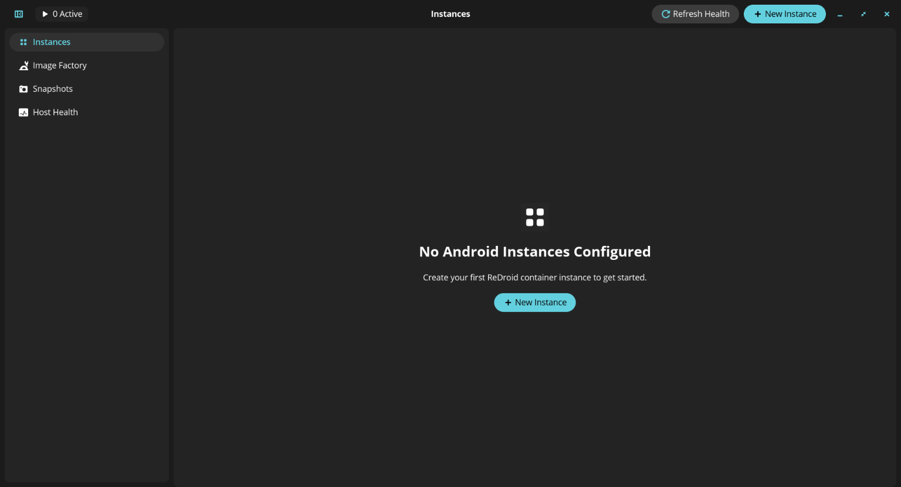
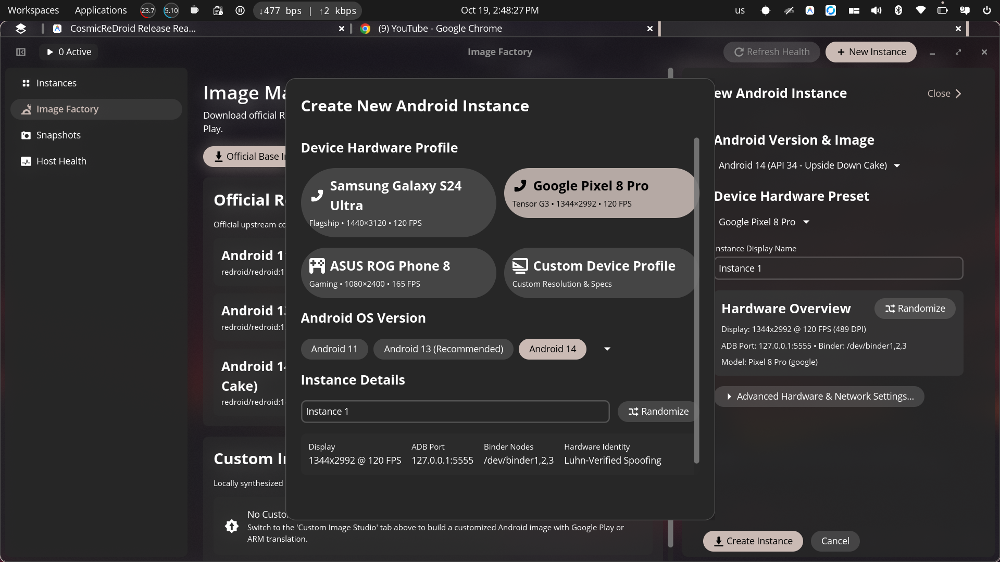

<div align="center">

# 🚀 CosmicReDroid

### Native Linux Android Multi-Instance Control Center
**Built with Rust, System76 `libcosmic`, and Docker Bollard Engine**

[](https://www.rust-lang.org/)
[](https://github.com/pop-os/libcosmic)
[](https://github.com/fussybeaver/bollard)
[](https://github.com/remote-android/redroid-doc)
[](LICENSE)

<br/>

<p align="center">
  
</p>

<p align="center">
  <em>Native COSMIC desktop dashboard managing containerized Android instances with real-time health telemetry.</em>
</p>

<p align="center">
  
</p>

<p align="center">
  <em>Hardware identity spoofing studio supporting Galaxy S24 Ultra, Pixel 8 Pro, ASUS ROG Phone 8, and custom device profiles.</em>
</p>

</div>

---

## 🌟 Key Capabilities

- 📱 **Multi-Instance Container Orchestration**: Spin up, configure, and isolate multiple concurrent Android environments (Android 11, 13, and 14) powered by ReDroid through the asynchronous **Docker Bollard API**.
- 🎭 **Hardware Identity Spoofing**: Built-in device profile engine with 1-click presets (**Samsung Galaxy S24 Ultra**, **Google Pixel 8 Pro**, **ASUS ROG Phone 8**) and custom device profiles featuring deterministic Luhn-verified IMEI, MAC, and Android ID generation.
- ⚡ **Kernel-Level Resource Isolation**: Deterministic Linux **BinderFS** character node allocation (`/dev/binderfs/binder1,2,3`) preventing IPC collisions between parallel Android containers.
- 🎮 **Direct DRI GPU Acceleration**: Pass-through host GPU acceleration via Linux Direct Rendering Infrastructure (`/dev/dri`) for high-framerate 120 FPS rendering and fluid gaming performance.
- 📸 **Copy-on-Write (CoW) Snapshots**: Instantaneous atomic instance branching, state checkpointing, and fast zstd-compressed rollback mechanisms.
- 🏭 **Integrated Image Factory**: Interactive studio for downloading official ReDroid base images or building customized images equipped with Google Play services (GApps) or ARM-to-x86 translation libraries (Houdini/NDK).
- 🩺 **Host Health Diagnostics & Remediation**: In-app inspection for kernel module prerequisites (`binder_linux`, `ashmem_linux`) with one-click `pkexec` privilege elevation and remediation.
- 🔊 **Audio & Screen Streaming**: Low-latency video mirroring and AAC audio streaming powered by integrated `scrcpy` connectivity.

---

## 🏗️ System Architecture

```
┌─────────────────────────────────────────────────────────────┐
│                 System76 libcosmic GUI                      │
│      (Wayland / wgpu / Fluent i18n / Reactive UI Loop)      │
└──────────────────────────────┬──────────────────────────────┘
                               │ Async Messages (tokio)
┌──────────────────────────────▼──────────────────────────────┐
│                    CosmicReDroid Core                       │
│  ┌─────────────────────────┐     ┌───────────────────────┐  │
│  │   Docker Bollard API    │     │   Hardware Generator  │  │
│  │ (Container Lifecycle)   │     │ (Luhn-Valid Identity) │  │
│  └────────────┬────────────┘     └───────────┬───────────┘  │
│               │                              │              │
│  ┌────────────▼────────────┐     ┌───────────▼───────────┐  │
│  │  CoW Snapshot Engine    │     │   Host Remediation    │  │
│  │ (zstd Compression)      │     │  (BinderFS & pkexec)  │  │
│  └─────────────────────────┘     └───────────────────────┘  │
└──────────────────────────────┬──────────────────────────────┘
                               │
┌──────────────────────────────▼──────────────────────────────┐
│                     Host Linux Kernel                       │
│  • /dev/binderfs (Isolated Nodes)   • /dev/dri (GPU Passthrough)
│  • ReDroid Android 11 / 13 / 14     • Docker Engine Daemon  │
└─────────────────────────────────────────────────────────────┘
```

---

## 🛠️ Prerequisites

- **OS**: Linux (Pop!_OS, Ubuntu 22.04+, or any Wayland-compatible distribution)
- **Kernel Modules**: `binder_linux` and `ashmem_linux` (CosmicReDroid includes automated health checks for these)
- **Runtime**: Docker Engine running with active socket permissions
- **Build Tools**: `rustc` / `cargo` (1.80+), `just`, and development headers for Wayland/wgpu

---

## 🚀 Building & Running

This project uses [`just`](https://github.com/casey/just) as the command runner:

```bash
# Clone the repository
git clone https://github.com/odai-dev/CosmicReDroid.git
cd CosmicReDroid

# Build the release binary
just build-release

# Run locally
just run

# Execute all unit and integration test suites
just test
```

---

## 📁 Repository Structure

```
CosmicReDroid/
├── src/
│   ├── main.rs              # Application entrypoint & cosmic loop
│   ├── lib.rs               # Library root & module exports
│   ├── app.rs               # State management & event handling
│   ├── backend/             # Docker Bollard client & container orchestration
│   ├── config/              # Persistent instance configuration models
│   ├── host/                # BinderFS & kernel module remediation
│   ├── spoofing/            # Hardware identity profiles & Luhn generators
│   └── ui/                  # System76 libcosmic widgets & views
├── resources/               # Desktop entries, AppStream XML & SVG icons
├── docs/screenshots/        # UI captures & architecture visuals
├── tests/                   # Integration & empirical stress test suites
├── justfile                 # Build, test, and desktop installation recipe
└── Cargo.toml               # Rust dependencies & package metadata
```

---

## 📄 License

Distributed under the **GPL-3.0** License. See [`LICENSE`](LICENSE) for details.
